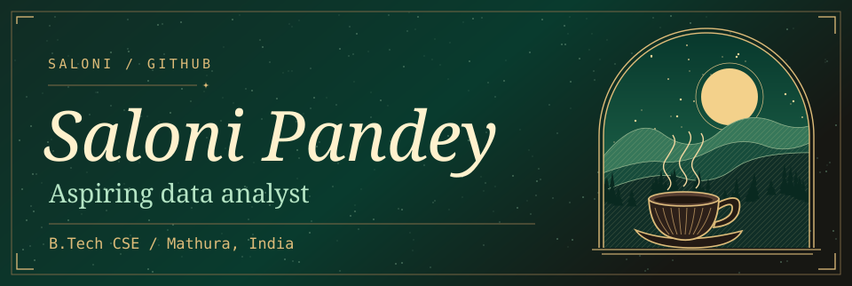
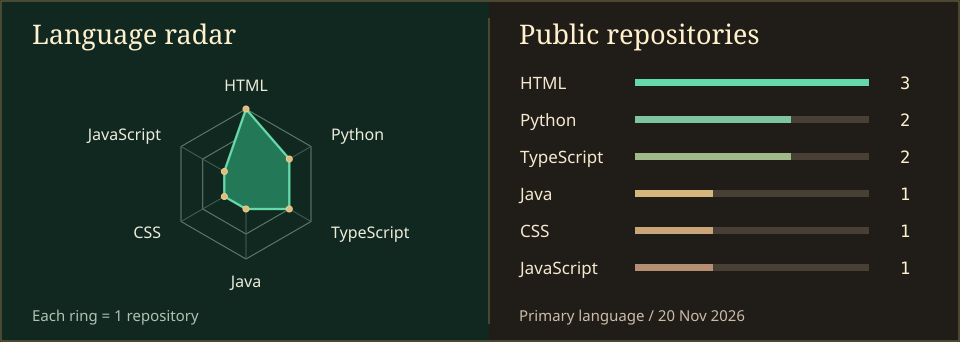
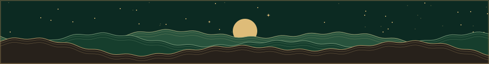

  

<h2 align="center">About me</h2>

I'm **Saloni**, a B.Tech Computer Science and Engineering student at Sanskriti University. I’m looking for data analyst internships and entry-level roles. I like questions I can test with data. For my fictional café, the first one is simple: **does the busiest hour also bring in the most revenue?**

- **At the café** · I’m planning an analysis of order volume and sales by hour using SQL, Excel, and Power BI.
- **In Python** · I’m practicing exploratory analysis with pandas and checking how missing values affect the answer.
- **In Java** · I work through [DSA problems](https://github.com/salonipandey-dev/Java-/tree/main/dsajava), test edge cases, and compare time and space complexity.
- **After hours** · Crochet, K-dramas, and a good cup of coffee.

<h2 align="center">Selected projects</h2>

**[MedAssist](https://github.com/salonipandey-dev/MedAssist)** · My major project. Its searchable consultation directory helps people explore care options. I’m building the prototype with React, FastAPI, and PostgreSQL.

**[ResQPaws](https://github.com/salonipandey-dev/ResQPaws)** · An animal rescue coordination prototype. Follow a demo report from the first sighting through case closure.

<h2 align="center">Languages &amp; activity</h2>

  

  

<h2 align="center">Get in touch</h2>

  <a href="https://www.linkedin.com/in/saloni-pandey-56b216290/"><strong>LinkedIn</strong></a> &nbsp;·&nbsp;
  <a href="mailto:salonipandey0716@gmail.com"><strong>Email me</strong></a> &nbsp;·&nbsp;
  <a href="https://github.com/salonipandey-dev/myportfolio"><strong>Portfolio source</strong></a>

