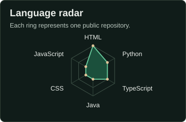
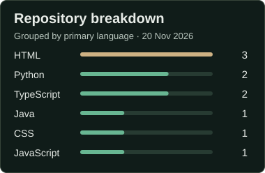

I’m a B.Tech Computer Science and Engineering student at Sanskriti University in Mathura, India, looking for **data analyst internships and entry-level roles**. I’m learning to turn business questions into SQL queries and explain the results in plain language.

[LinkedIn](https://www.linkedin.com/in/saloni-pandey-56b216290/) · [Email](mailto:salonipandey0716@gmail.com) · [Portfolio source](https://github.com/salonipandey-dev/myportfolio)

## Selected projects

**[MedAssist](https://github.com/salonipandey-dev/MedAssist)** · React, FastAPI, PostgreSQL  
My B.Tech major project helps people explore care options through a searchable consultation directory. Demo patient profiles show how the directory fits into the patient experience.

**[ResQPaws](https://github.com/salonipandey-dev/ResQPaws)** · Animal rescue coordination  
A prototype for following a rescue report from the first sighting through case closure.

## Current work

- **Café order analysis** · Does the busiest hour also bring in the most revenue? I’m planning to compare order counts and sales by hour in a fictional café dataset using SQL, Excel, and Power BI.
- **Python and Java** · I’m exploring missing values in pandas and practicing [data structures and algorithms in Java](https://github.com/salonipandey-dev/Java-/tree/main/dsajava), with a focus on edge cases and complexity.

## Languages and activity

  
  

  

